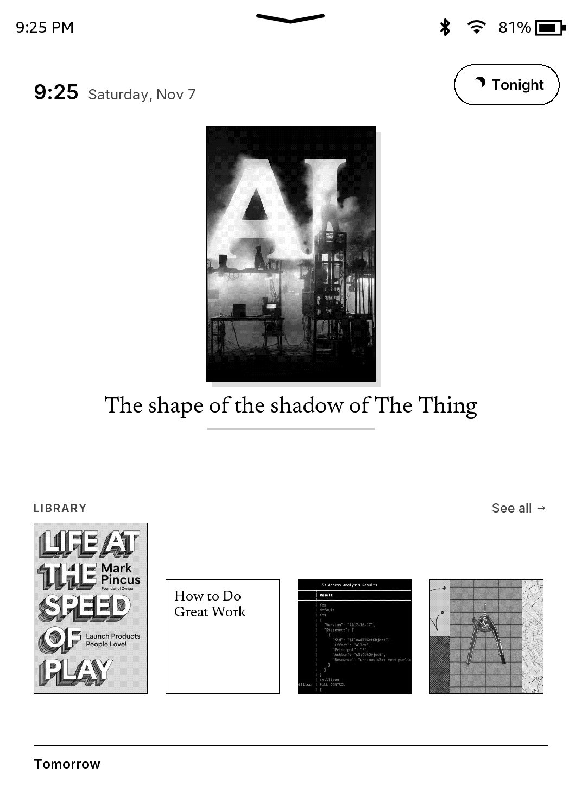
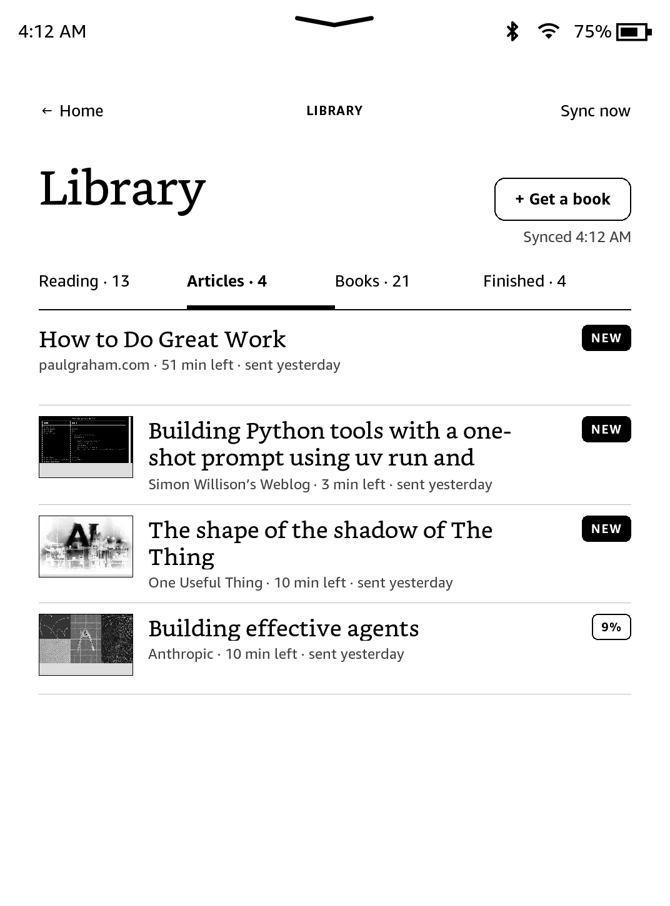
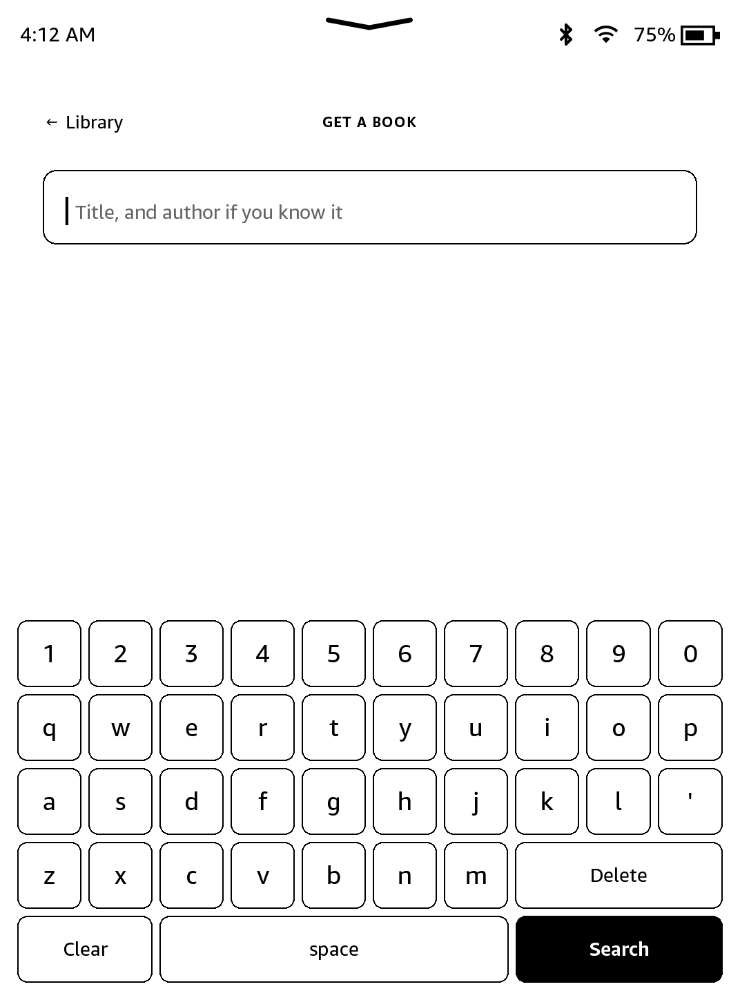
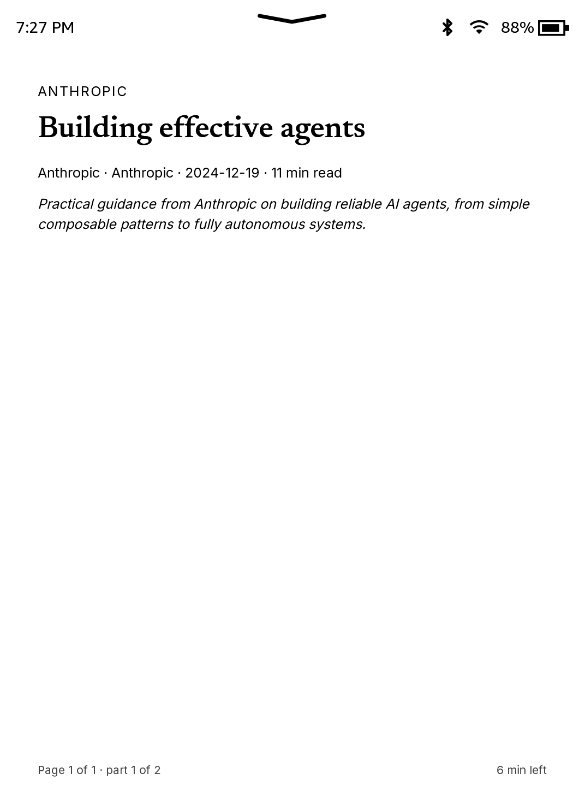
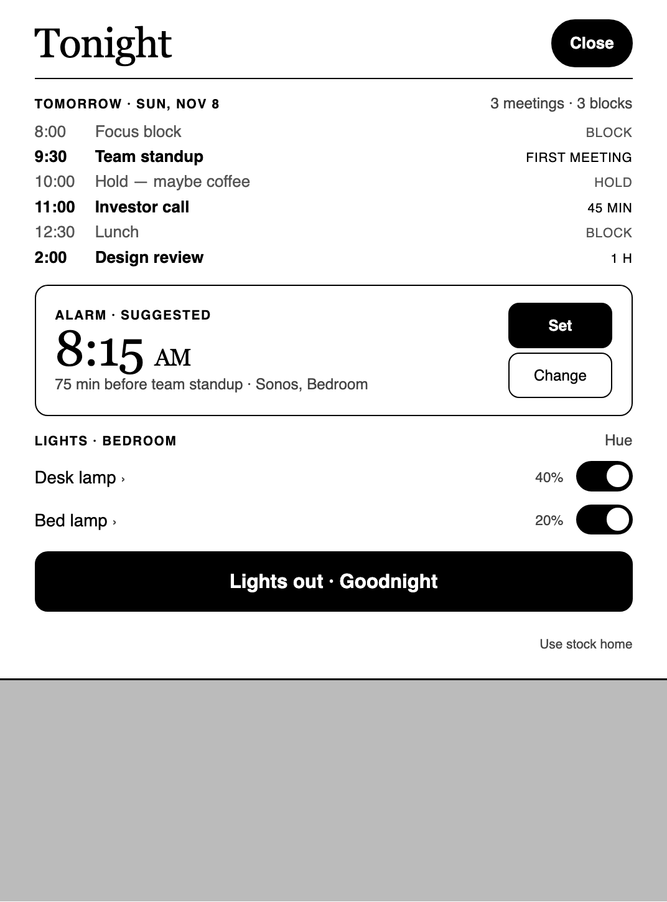
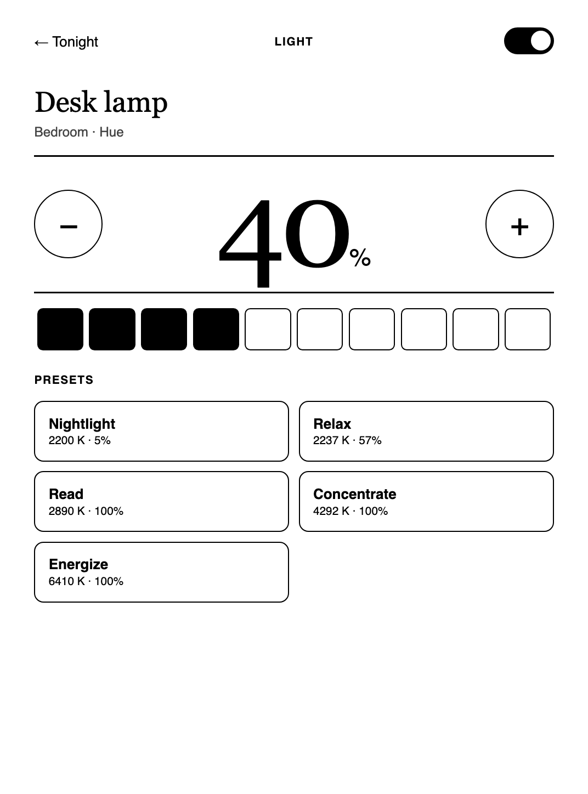
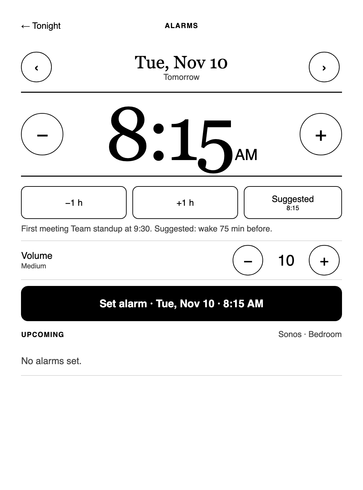
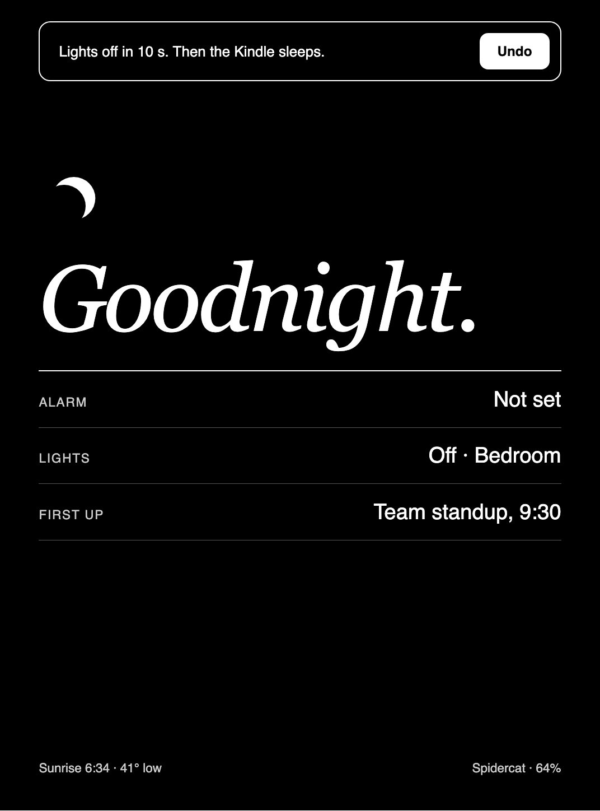

# Nightstand

A calm home screen and e-book reader for a jailbroken Kindle Paperwhite.

Nightstand replaces the stock Kindle home with a bedside screen:
- a clock and your current read,
- tomorrow's calendar and a suggested alarm on your Sonos,
- your Hue lamps and a **Lights out · Goodnight** button,
- a photo lock screen.

It also has its own reader and its own delivery. Send an article from your phone or
ask Claude for a book. The server turns it into a clean EPUB, and the Kindle pulls it
over Wi-Fi. No Amazon Send to Kindle, no email, no cable.

| Home | Library | Get a book | Reader |
|---|---|---|---|
|  |  |  |  |

| Tonight | Light | Alarms | Goodnight |
|---|---|---|---|
|  |  |  |  |

<sub>The top row is from a real Kindle. The bottom row is from the desktop preview with sample data.</sub>

> **Status.** This is a personal project that works every day on one device: a
> Kindle Paperwhite 4 (10th gen) on firmware 5.18.1.1.1. Other models and firmware
> may need changes. Read the code before you run it on your Kindle.

---

## Contents

- [What you get](#what-you-get)
- [How it works](#how-it-works)
- [What you need](#what-you-need)
- [Setup](#setup)
  - [1. The server (Cloudflare, free tier)](#1-the-server-cloudflare-free-tier)
  - [2. The Kindle](#2-the-kindle)
  - [3. Optional: Hue lamps](#3-optional-hue-lamps)
  - [4. Optional: Sonos alarm](#4-optional-sonos-alarm)
  - [5. Optional: calendar](#5-optional-calendar)
  - [6. Optional: AI clean-up of articles](#6-optional-ai-clean-up-of-articles)
  - [7. Send articles from your phone](#7-send-articles-from-your-phone)
  - [8. Ask Claude (MCP)](#8-ask-claude-mcp)
  - [9. Optional: the courier (Shelfmark)](#9-optional-the-courier-shelfmark)
- [Everyday commands](#everyday-commands)
- [Turn it off](#turn-it-off)
- [Things that will bite you](#things-that-will-bite-you)
- [Repo layout](#repo-layout)

---

## What you get

| Screen | What it does |
|---|---|
| **Home** | Clock, date, the cover of what you read last with a progress bar, the next four items in your library, and a strip with tomorrow's first meeting, the alarm, and the weather. |
| **Tonight** | Tomorrow's calendar (meetings in black, focus blocks in gray), a suggested alarm, your lamps, **Lights out**, and **Use stock home**. |
| **Light** | One lamp: brightness steps and Hue presets (Nightlight, Relax, Read, Concentrate, Energize). |
| **Alarms** | Alarms for any date and time on a Sonos speaker, with a volume setting. |
| **Library** | Reading, Articles, Books, and Finished tabs. **Sync now**. Books on their way show under **Coming** with a progress bar. |
| **Get a book** | An on-screen keyboard. Search, tap a result, and the book arrives in the Library. |
| **Reader** | Paged EPUB reader: tap left or right to turn pages, tap the middle for the menu, change the text size, open the contents. Progress syncs to the server. |
| **Goodnight** | Fades the lamps off over 10 s (with Undo), then the Kindle sleeps on a dark Goodnight screen. |
| **Lock screen** | Your photo, converted for e-ink. |

**The suggested alarm** is your first real meeting minus 75 minutes, kept between
7:00 and 9:00. A small model labels each event as a meeting, a block, a hold, or
something to skip, so a "Focus time" block does not wake you early.

**Books you bought from Amazon** have DRM. Nightstand shows them on the shelf with
their real covers and progress, and a tap opens them in Amazon's reader. Nightstand
never removes DRM.

---

## How it works

```
 Claude (MCP)      phone share sheet / bookmarklet
      │                    │
      ▼                    ▼
┌───────────────────────────────────────────┐
│  Server: Cloudflare Worker                │
│  D1 database · R2 file storage            │
│  calendar · weather · article clean-up    │
└─────▲─────────────────────────▲───────────┘
      │ the Kindle pulls        │ (optional) the courier long-polls
      │                         │
┌─────┴──────────────┐   ┌──────┴──────────────────────┐
│ Kindle             │   │ Any always-on Linux box     │
│ Nightstand app     │   │ courier.py → Shelfmark      │
│ helper :8765       │   └─────────────────────────────┘
│  ├─ Hue bridge     │
│  └─ Sonos          │
└────────────────────┘
```

- **The Kindle app** (`app/`) is an HTML app that runs in the Kindle's built-in web
  runtime ("Mesquite").
- **The helper** (`device/bin/helper.sh`) is a tiny HTTP server on the Kindle at
  `127.0.0.1:8765`. It does what a web page cannot: it talks to Hue and Sonos on
  your Wi-Fi, downloads books, reads the Amazon library, and draws the lock screen.
- **The server** (`server/`) is a Cloudflare Worker. It builds EPUBs, stores them,
  reads your calendar, and answers Claude over MCP.
- **Nothing connects into your Kindle or your box.** They both reach out to the
  server, so neither needs an open port.
- **Every book passes a check before it reaches the Kindle.** The server rejects
  files with DRM, the wrong book, samples, and broken EPUBs.

---

## What you need

| Need | Notes |
|---|---|
| A jailbroken Kindle | Follow [kindlemodding.org](https://kindlemodding.org). Tested on a Paperwhite 4, firmware 5.18.1.1.1. |
| KOReader with its SSH plugin | Used once, to get SSH onto the Kindle. |
| A Cloudflare account | The free tier is enough (Workers, D1, R2). |
| Node.js 20+ on your computer | For `wrangler`, the Cloudflare CLI. |
| `uv` or Python 3 with Pillow | Only for screenshots and the lock screen converter. |
| Optional | Philips Hue bridge · Sonos speaker · Google Calendar · an OpenAI API key · an always-on Linux box for the courier |

---

## Setup

Clone the repo and copy the example config. Everything in `private/` is ignored by
git, so your keys stay on your computer.

```sh
git clone https://github.com/sjhangiani12/nightstand.git && cd nightstand
cp -R private.example private
```

### 1. The server (Cloudflare, free tier)

```sh
cd server
npm install
npx wrangler login

npx wrangler d1 create nightstand              # copy the database_id it prints…
#   …into server/wrangler.toml, in place of YOUR_D1_DATABASE_ID
npx wrangler r2 bucket create nightstand-books
npx wrangler d1 migrations apply nightstand --remote
```

Set your time zone in `server/wrangler.toml` (`TIMEZONE`, for example
`America/Los_Angeles`). Then set the secrets:

```sh
openssl rand -hex 24                            # make a key, and keep it
npx wrangler secret put SERVER_KEY              # paste that key
npx wrangler secret put HOME_LAT                # for the weather, e.g. 37.77
npx wrangler secret put HOME_LON                # e.g. -122.42
npx wrangler deploy                             # prints your URL
```

Put the URL and the key in `private/config/server.env`. Check the server:

```sh
curl -H "Authorization: Bearer YOUR_KEY" https://nightstand-server.YOU.workers.dev/tonight
```

### 2. The Kindle

1. Jailbreak the Kindle. Install KOReader and its SSH plugin.
2. Connect the Kindle over USB. Copy your public key (for example
   `~/.ssh/id_ed25519.pub`) to `koreader/settings/SSH/authorized_keys` on the Kindle.
3. In KOReader, start the SSH server: **Tools → Network → SSH server**. It uses port 2222.
4. Put the Kindle's IP address in `private/config/tools.env`.
5. Optional: put your own photo on the lock screen.
   ```sh
   uv run --with pillow python -I lockscreen/eink.py my-photo.jpg device/lockscreen.png
   ```
6. Run the installer:
   ```sh
   tools/setup-kindle.sh          # add --boot to start Nightstand when the Kindle starts
   ```

The installer does the following:
- It sets up the Kindle's own SSH server on port 2223, using KOReader's `dropbear`
  and your key.
- It copies the device scripts, your config, and the app.
- It registers the app with the Kindle.

Nightstand then opens. Afterwards, you can start it again from the **Nightstand**
item in the Kindle library. You do not need KOReader's SSH server again.

**Start at boot** (`--boot`) writes one file to the system partition:
`/etc/upstart/nightstand.conf`. Leave it out at first. Add it when you trust the
setup. [Turn it off](#turn-it-off) explains how to remove it.

### 3. Optional: Hue lamps

1. Find your bridge's IP address in the Hue app (**Settings → My Hue system**).
2. Press the button on the bridge. Within 30 seconds, run:
   ```sh
   curl -s -X POST -d '{"devicetype":"nightstand#kindle"}' http://BRIDGE_IP/api
   ```
3. Copy the `username` into `HUE_USER` in `private/config/hue.env`.
4. Find the lamp IDs:
   ```sh
   curl -s http://BRIDGE_IP/api/USERNAME/lights
   ```
5. Put the IDs in `HUE_LAMPS`, separated by spaces.
6. Set `ROOM_NAME` to the name you want the app to show.

### 4. Optional: Sonos alarm

1. In the Sonos app, make an alarm with the sound you want to wake up to. You can
   leave it turned off. Nightstand only copies its sound and never changes it.
2. Run the Sonos helper with the speaker's IP address:
   ```sh
   python3 tools/sonos-find.py SONOS_IP            # lists rooms and alarms
   python3 tools/sonos-find.py SONOS_IP ALARM_ID   # copies that alarm's sound
   ```
3. Put the speaker's IP address and the room UUID in `private/config/sonos.env`.

After a config change, run `tools/setup-kindle.sh` again with `PORT=2223`, or copy
the files to `/mnt/us/nightstand/config/` on the Kindle.

### 5. Optional: calendar

Pick one of these:

- **Google Calendar (recommended).**
  1. Make a service account in a Google Cloud project and enable the Calendar API.
  2. Share each calendar with the service account's email address, with "See all
     event details".
  3. Set the secrets:
     ```sh
     npx wrangler secret put GOOGLE_SA_KEY         # the service account JSON key
     npx wrangler secret put GOOGLE_CALENDAR_IDS   # calendar IDs, comma separated
     npx wrangler secret put OWNER_EMAILS          # your addresses, to skip events you declined
     ```
- **iCal links.** Set `ICS_URLS` to your calendars' secret iCal addresses, comma
  separated.

### 6. Optional: AI clean-up of articles

```sh
npx wrangler secret put OPENAI_API_KEY
```

With a key, the server labels each block of an article and drops ads, navigation,
and sign-up boxes. It also labels calendar events. The cost is about $0.001–0.003
per article. Without a key, articles still work through Readability alone, and
calendar events use simple rules.

### 7. Send articles from your phone

- **Bookmarklet.** Make a bookmark with this URL:
  ```
  javascript:location.href='https://YOUR-SERVER/add?key=YOUR_KEY&url='+encodeURIComponent(location.href)
  ```
- **iOS Shortcut.** Make a shortcut that accepts URLs from the share sheet. Give it
  one **Get contents of URL** action that opens
  `https://YOUR-SERVER/add?key=YOUR_KEY&url=<Shortcut Input>`.

The article reaches the Kindle on its next sync, or when you tap **Sync now**.

### 8. Ask Claude (MCP)

Add a custom connector in Claude with this address:

```
https://YOUR-SERVER/mcp?key=YOUR_KEY
```

| Tool | What it does |
|---|---|
| `send_to_kindle` | Turn a URL, HTML, or text into an article on the Kindle |
| `find_book` | Find a book. Identity comes from Open Library. Free copies come from Project Gutenberg, plus Shelfmark if you run the courier. |
| `get_book` | Get a found book, or the best match for a title |
| `list_kindle_items`, `get_kindle_item`, `retry_kindle_item`, `list_books`, `remove_book` | Manage what is on the Kindle |

Then ask: *"Put Middlemarch on my Kindle."*

### 9. Optional: the courier (Shelfmark)

Out of the box, **Get a book** finds public-domain books from Project Gutenberg. To
search more places, run [Shelfmark](https://github.com/calibrain/shelfmark) on an
always-on Linux box, with `courier/courier.py` next to it. The courier connects
Shelfmark to your server. It long-polls the server for searches and requests, asks
Shelfmark, and uploads the finished EPUB.

> Shelfmark ships with every download source turned off. Which sources you enable
> is your choice and your responsibility. Use sources you have the right to use.

On the box (Ubuntu with Docker):

```sh
sudo useradd --system --uid 1500 --create-home --home-dir /srv/books books
sudo mkdir -p /srv/books/{config,books,courier}
sudo cp courier/docker-compose.yml /srv/books/
sudo cp courier/courier.py /srv/books/courier/
sudo cp private/config/courier.env /srv/books/courier/courier.env   # fill it in first
sudo chown -R books:books /srv/books && sudo chmod 600 /srv/books/courier/courier.env
sudo docker compose -f /srv/books/docker-compose.yml up -d

sudo cp courier/nightstand-courier.service /etc/systemd/system/
sudo systemctl enable --now nightstand-courier
```

On the server, set the courier's own key. Use the same value as in `courier.env`:

```sh
npx wrangler secret put COURIER_KEY
```

Shelfmark's web UI listens only on the box itself. To open it, run
`ssh -N -L 8084:127.0.0.1:8084 you@box`, then go to http://localhost:8084.

Notes:
- Install Calibre (`ebook-convert`) on the box if you allow AZW3 or MOBI files. The
  courier converts them to EPUB.
- `infra/` has cloud-init templates for a small Hetzner box that joins Tailscale
  and has no open ports.

---

## Everyday commands

```sh
tools/deploy.sh [view]        # push app/ to the Kindle; it reloads itself, then a screenshot
tools/shot.sh out.png         # screenshot of the Kindle's screen
tools/install-device.sh       # push device/ scripts
ssh -p 2223 root@KINDLE_IP    # shell on the Kindle

cd server && npx wrangler deploy                          # server
npx wrangler d1 migrations apply nightstand --remote      # after a new migration
```

**Preview on your computer.** Open `app/index.html` in a browser. Add `#tonight`,
`#alarm`, `#library`, `#books`, or `#goodnight` to the URL. Sample data in
`app/js/data.js` stands in for the Kindle.

---

## Turn it off

- **For one visit:** Tonight → **Use stock home**. The next Home press brings
  Nightstand back.
- **Until you remove it:** connect over USB and create an empty file named
  `NIGHTSTAND_OFF` at the top of the Kindle drive. Then restart the Kindle.
- **Remove it completely:**
  1. Run `mntroot rw; rm /etc/upstart/nightstand.conf; mntroot ro` over SSH.
  2. Delete `/mnt/us/nightstand` and `documents/Nightstand.sh`.
  3. Restart the Kindle.

---

## Things that will bite you

The Kindle's web engine is very old (WebKit about 1.2). We learned these the hard way:

- **ES5 only.** No `let`, arrow functions, `fetch`, or promises. Use table layout:
  no flexbox, no grid, no `rem`, no `object-fit`.
- **Never use a CSS `transform` scale.** Glyphs disappear. Scale with `body.style.zoom`.
- **Use the Kindle's own fonts** ("Amazon Ember", "Bookerly"). Web fonts make
  letters vanish at random.
- **Force a full repaint after DOM changes.** Otherwise the engine repaints too
  small an area, and text goes missing.
- **Errors are silent.** `window.onerror` posts them to the helper. Read them in
  `/tmp/nightstand-js.log` on the Kindle.
- **Never kill the app's process to reload it.** The Kindle shows an "Application
  Error" dialog that only a tap can close. `tools/deploy.sh` writes a build stamp,
  and the app reloads itself within 15 seconds.
- **Never `pkill -f` over SSH** with a pattern that is also in your SSH command. It
  kills your own session. `device/bin/stop.sh` stops the daemon by PID.
- **No Python on the Kindle.** The helper is BusyBox `tcpsvd` plus shell, `curl`,
  and `sqlite3`.
- **Kindles with Special Offers** show an ad on wake. The daemon swaps in the plain
  screensaver module once per boot, and it shows your photo through a bind mount.
  Nothing on the system partition changes.
- **Some sites block Cloudflare Workers.** Substack returns 429, so the server uses
  Substack's JSON API. Standard Ebooks returns 403.
- **The Kindle's web engine has no WebP.** The server keeps only JPEG, PNG, and GIF
  images.

---

## Repo layout

```
app/              The Kindle app: index.html, css/, js/ (app, reader, device, sample data)
device/           Runs on the Kindle: helper, daemon, alarms, boot job, lock screen photo
server/           Cloudflare Worker: articles, books, library + MCP, calendar, EPUB builder
courier/          Optional: courier.py, Shelfmark compose file, systemd unit
infra/            cloud-init templates for a small Hetzner box on Tailscale
tools/            setup-kindle.sh, deploy.sh, shot.sh, install-device.sh, sonos-find.py
lockscreen/       eink.py (photo → 16-gray e-ink image) and an example photo
private.example/  Example config. Copy it to private/ (ignored by git).
shots/            Screenshots from a real Kindle (1072 × 1448)
```

## License

MIT. See [LICENSE](LICENSE).
